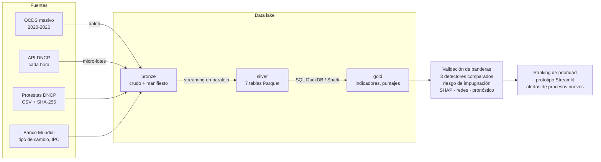

# Detección de riesgo en contrataciones públicas mediante Big Data y aprendizaje automático

[](https://colab.research.google.com/github/bethavila17/dncp-riesgo-contrataciones/blob/main/notebooks/00_pipeline_completo.ipynb)


**Proyecto III – Big Data · Maestría en Ciencia de Datos · Universidad Comunera (UCOM), Asunción – Paraguay**
Autores: Bethania Avila, Arturo Fernández, Gustavo Bogado

Sistema que captura, almacena, procesa y analiza los datos abiertos de la **Dirección Nacional de Contrataciones Públicas (DNCP)** de Paraguay (estándar OCDS, 2020–2026) para asignar a cada proceso una **prioridad de auditoría** explicable. Es un insumo para planificar auditorías: identifica patrones de riesgo para revisar, **no determina irregularidades**.

📄 Informe completo: [`informe/Proyecto_III_BigData_DNCP.docx`](informe/Proyecto_III_BigData_DNCP.docx) ([PDF](informe/Proyecto_III_BigData_DNCP.pdf))

---

## Cumplimiento de los objetivos del trabajo práctico

| Objetivo del TP | Implementación | Dónde |
|---|---|---|
| **1. Captura de datos de múltiples fuentes** | 4 fuentes automatizadas: descargas masivas OCDS (2020–2026), API REST de la DNCP (micro-lotes cada hora), módulo de protestas y denuncias (CSV con SHA-256) y API del Banco Mundial. Manifiesto con huella SHA-256 de cada archivo. | [`ingesta/`](src/dncp_riesgo/ingesta), notebook 01 |
| **2. Almacenamiento escalable** | Data lake por capas (bronze / silver / gold) en Parquet + Zstd, particionado por lote de ingesta, con catálogo SQL en DuckDB; legible también por Apache Spark. | [`almacenamiento/`](src/dncp_riesgo/almacenamiento), notebooks 01 y 06 |
| **3. Procesamiento en minutos** | Lectura en streaming, normalización en paralelo, SQL columnar. Pipeline completo 2020–2026 en **9 minutos** desde la terminal (unos 20 dentro de un notebook) en una PC personal; procesos nuevos de la API se puntúan sin reentrenar. | [`procesamiento/`](src/dncp_riesgo/procesamiento), notebooks 00 y 05 |
| **4. Analítica predictiva** | Validación de banderas rojas (regresión logística), 3 detectores de anomalías comparados con métricas definidas de antemano, modelo de riesgo de impugnación, SHAP, redes de colusión y pronóstico de tendencias. | [`modelos/`](src/dncp_riesgo/modelos), notebooks 02–04 |

## El problema como problema de Big Data

| Dimensión | Cómo se presenta | Cómo la resuelve el sistema |
|---|---|---|
| **Volumen** | 0,86 GB comprimidos, **9,1 GB de JSON**, 90.470 procesos y **10,5 millones de objetos anidados** (5,7 millones de ítems) en 2020–2026 | Streaming + paralelismo por archivo; Parquet columnar (9,1 GB → 157 MB); SQL fuera de memoria; versión Spark |
| **Velocidad** | La API de la DNCP se actualiza cada hora | Micro-lotes incrementales desde la API; puntuación inmediata con modelos persistidos |
| **Variedad** | JSON anidado, CSV, APIs JSON, texto libre, dos monedas | 7 tablas relacionadas por `ocid`, integración de 4 fuentes, guaraníes constantes |
| Veracidad | Montos con moneda mal declarada, fechas fuera de rango, quejas solo en una fuente | Reglas de calidad registradas por proceso, verificación SHA-256 (42/42 CSV), cruce de fuentes |

## Arquitectura



## Medición cuantitativa de los algoritmos

Las métricas se definieron **antes de entrenar**. No existe una etiqueta oficial de irregularidad: los casos de referencia son los procesos con protesta, denuncia o investigación de la DNCP. Validación temporal: **entrenamiento 2021–2024, prueba 2025**, procesos de 2026 como nuevos.

| Métrica | Qué mide | Por qué |
|---|---|---|
| **AUC-PR** (principal) | Área bajo la curva precisión–exhaustividad | Adecuada con clases escasas (5–10 % de casos) |
| Precision@k, Lift@k | Aciertos entre los k procesos de mayor puntaje; mejora sobre el azar | El auditor revisa k procesos |
| Recall y F1 al 5 % superior | Cobertura con capacidad de revisión fija | Simula la capacidad de auditoría |
| ROC-AUC | Capacidad general de ordenar | Complementaria |
| Estabilidad | Spearman y Jaccard del 5 % superior entre 5 reentrenamientos | Un ranking que cambia no sirve para auditar |
| Costo | Segundos de entrenamiento, ms por 1.000 procesos | Relevante en Big Data |

**Regla de decisión:** (a) se descartan los detectores inestables (Jaccard < 0,5); (b) gana el mayor AUC-PR; (c) si la diferencia es < 0,02, gana la mayor Precision@100; (d) si persiste el empate, el de menor costo. Para los detectores, la métrica principal se mide en procesos con 2 o más oferentes, porque las protestas crecen con la competencia.

### Resultados (prueba temporal 2025)

**Detectores de anomalías** (procesos con ≥2 oferentes; tasa base 7,4 %):

| Método | AUC-PR | P@100 | Lift@100 | Jaccard 5 % | Costo de entrenamiento |
|---|---|---|---|---|---|
| **Isolation Forest global** ✅ | **0,172** | **0,35** | **4,8** | 0,66 | 1× |
| Autoencoder | 0,114 | 0,12 | 1,6 | 0,33 ❌ inestable | 26× |
| Isolation Forest por modalidad | 0,106 | 0,11 | 1,5 | 0,63 | 2× |
| Índice de reglas validado (CRI) | 0,074 | 0,11 | 1,5 | 0,80 | 1× |

Costo de entrenamiento relativo al Isolation Forest global.

**Elegido: Isolation Forest global.** El Autoencoder se descarta por inestable (su 5 % superior cambia demasiado entre corridas) y el Isolation Forest global supera al bosque por modalidad por 0,066 de AUC-PR.

**Riesgo de impugnación** (supervisado; tasa base 5,3 %):

| Modelo | AUC-PR | ROC-AUC | P@100 | Lift@100 |
|---|---|---|---|---|
| **LightGBM** ✅ | **0,434** | 0,906 | 0,65 | 12,3 |
| XGBoost | 0,404 | 0,902 | 0,64 | 12,1 |
| Regresión logística | 0,395 | 0,897 | 0,63 | 11,9 |
| Línea base: solo monto estimado | 0,182 | 0,756 | 0,34 | 6,4 |
| Línea base: solo n.º de oferentes | 0,130 | 0,702 | 0,32 | 6,1 |

Las protestas miden **conflictividad**, no irregularidad (crecen con la cantidad de oferentes), por eso este modelo se informa **aparte** del riesgo de integridad.

### Otros hallazgos

- **Prioridad de auditoría:** el 5 % de procesos con mayor prioridad en 2025 concentra el **32,2 % del monto adjudicado**, con 77,8 % de oferente único (frente a 42,4 %) y el doble de casos de referencia.
- **Banderas validadas:** integran el índice el oferente único, la excepción, el adjudicado mayor al estimado (OR 1,74), el proveedor dominante (OR 1,35) y la publicación a fin de año (OR 1,34); se descartan la evaluación prolongada, el sobreprecio por ítem, el proveedor nuevo, la ampliación y el plazo corto.
- **Competencia:** los procesos con oferente único pasaron de 26 % (2021) a 43 % (2025) y 48 % (2026), coincidiendo con la Ley 7021/2022; el pronóstico (SARIMA, MAPE 5,2 %) anticipa que se mantendrá cerca del 45–48 %.
- **Redes:** 40 entidades con concentración alta (HHI ≥ 2.500) y 153 pares de proveedores con patrón de rotación (120) u oferta de cobertura (33).
- **Calidad:** 33 adjudicaciones en guaraníes declaradas como USD (sin corregirlas, los totales se multiplican por miles), 136 montos inconsistentes y 140 fechas fuera de rango.

## Estructura del repositorio

```
├── config/config.yaml           # parámetros: años, fechas de validación, métricas, pesos
├── src/dncp_riesgo/
│   ├── ingesta/                 # 4 fuentes: OCP Data Registry, API DNCP, protestas, Banco Mundial
│   ├── almacenamiento/          # data lake (bronze/silver/gold), normalización OCDS -> Parquet
│   ├── procesamiento/           # indicadores (SQL DuckDB), versión Spark, benchmarks
│   ├── modelos/                 # validación de banderas, detectores, supervisados, evaluación,
│   │                            # SHAP, redes, series de tiempo y puntaje final
│   ├── graficos.py              # estilo común de las figuras
│   └── pipeline.py              # orquestador de las etapas
├── notebooks/                   # 00 a 06, ejecutables en Google Colab (con salidas)
├── app/streamlit_app.py         # prototipo de consulta para auditores
├── informe/                     # informe (Word/PDF), figuras y su generador
├── scripts/ejecutar_pipeline.py # ejecución completa desde la terminal
├── tests/                       # pruebas unitarias (pytest)
└── data/                        # data lake (se genera al ejecutar; no se versiona)
```

## Cómo ejecutarlo

### En Google Colab (recomendado)

1. Abrir [`notebooks/00_pipeline_completo.ipynb`](notebooks/00_pipeline_completo.ipynb) con el botón **Abrir en Colab**.
2. **Entorno de ejecución → Ejecutar todas.** El notebook clona el repositorio, instala lo que falta, descarga los datos (~0,9 GB) y ejecuta todo (~10–15 minutos en Colab).
3. Para no repetir la descarga entre sesiones, poner `USAR_DRIVE = True` en la primera celda (guarda el data lake en Google Drive).

Cada notebook (01 a 06) se puede abrir por separado: si faltan datos, los genera.

| Notebook | Contenido |
|---|---|
| [00](notebooks/00_pipeline_completo.ipynb) | Pipeline completo y tiempos por etapa |
| [01](notebooks/01_captura_y_almacenamiento.ipynb) | Captura multifuente, volumen, integridad, data lake, benchmarks |
| [02](notebooks/02_exploracion_e_indicadores.ipynb) | Exploración, banderas rojas y validación de constructo |
| [03](notebooks/03_modelos_y_evaluacion.ipynb) | Medición cuantitativa y elección del mejor algoritmo |
| [04](notebooks/04_redes_y_tendencias.ipynb) | Redes de colusión y pronóstico de tendencias |
| [05](notebooks/05_tiempo_casi_real_y_prototipo.ipynb) | Micro-lotes desde la API y prototipo |
| [06](notebooks/06_spark_distribuido.ipynb) | Procesamiento distribuido con Apache Spark |

### En una computadora local

```bash
python -m venv .venv
.venv/Scripts/activate            # Windows   (Linux/Mac: source .venv/bin/activate)
pip install -r requirements.txt
python scripts/ejecutar_pipeline.py --data-dir C:/dncp_lake
streamlit run app/streamlit_app.py -- --data-dir C:/dncp_lake
```

Opciones útiles: `--anios 2025` (prueba rápida con un año), `--etapas gold modelos` (recalcular sin volver a descargar). Pruebas: `pytest -q`. Informe: `python informe/generar_figuras.py C:/dncp_lake` y luego `python informe/generar_informe.py C:/dncp_lake`.

> Conviene ubicar el data lake fuera de carpetas sincronizadas (OneDrive, Dropbox): ocupa ~1,5 GB.

## Limitaciones

- No existe una etiqueta oficial de irregularidad: la validación es de constructo, de estabilidad y contra casos de referencia.
- El volcado anual de 2026 está incompleto desde abril de 2026; la API completa los procesos recientes con un límite de 15 llamadas por minuto.
- La Ley 7021/2022 cambió las modalidades en 2024; las comparaciones temporales deben leerse con esa ruptura.
- Los patrones de red pueden tener explicaciones legítimas y requieren revisión documental.

## Datos y licencia

Código bajo licencia [MIT](LICENSE). Datos: DNCP y OCP Data Registry ([publicación 63](https://data.open-contracting.org/en/publication/63)), licencia CC BY 4.0; Banco Mundial, licencia CC BY 4.0.
